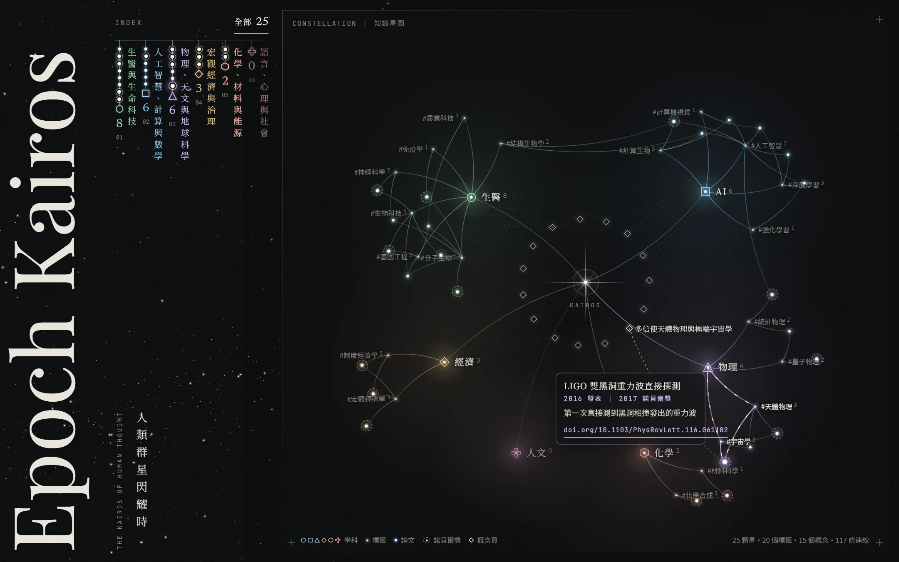
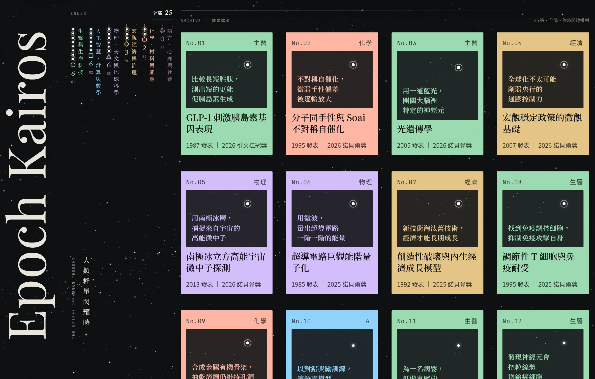
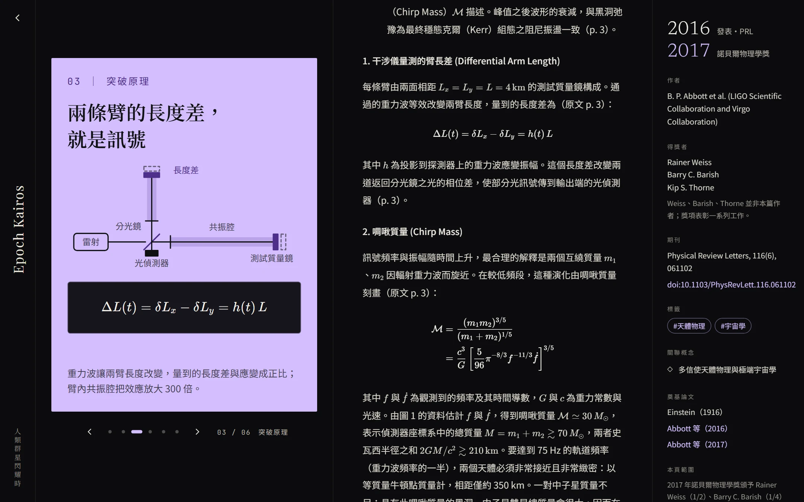
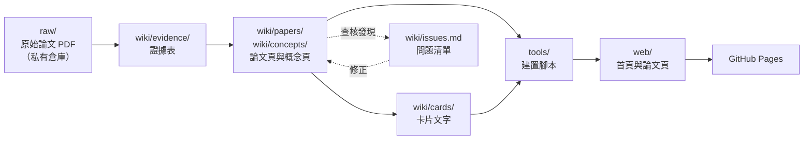

# Epoch-Kairos｜人類群星閃耀時

[](https://github.com/zhi816/Epoch-Kairos/actions/workflows/pages.yml)
[](./LICENSE)
[](#快速開始)

> 在漫長的客觀時間（Chronos）中，唯有那些改變人類文明軌跡的決定性時刻（Kairos），宛如夜空中驟然閃耀的群星。

跨學科里程碑論文與個人研究關注的知識庫。以 Andrej Karpathy 的 [LLM Wiki](https://gist.github.com/karpathy/442a6bf555914893e9891c11519de94f) 三層架構為基礎，由多個 AI 代理協作維護：每個數字與公式都對應到原文頁碼，再自動編譯成知識星圖首頁與「3:4 知識圖卡＋學術長文」雙欄論文頁。

**線上瀏覽：[zhi816.github.io/Epoch-Kairos](https://zhi816.github.io/Epoch-Kairos/)**

| 首頁知識星圖 | 群星檔案卡片牆 |
|---|---|
|  |  |



## 目錄

- [特色](#特色)
- [運作方式](#運作方式)
- [快速開始](#快速開始)
- [專案結構](#專案結構)
- [作業技能](#作業技能)
- [知識條目規則](#知識條目規則)
- [開發歷程](#開發歷程)
- [致謝與設計來源](#致謝與設計來源)
- [授權](#授權)

## 特色

- **主張可追溯到原文**：寫頁面之前先建立證據表（`wiki/evidence/`），把數值、公式與「首次／證明」等強斷言逐條對應到原文之頁、表、圖；區塊公式只放原文中找得到的式子。
- **查核問題有追蹤**：查出的錯誤登記於問題清單並追蹤到修正，結案後依頁歸檔；197 筆已結案問題另歸納成[常見錯誤清單](./.agents/skills/wiki-content-audit/references/common-errors.md)，供撰寫與查核前閱讀。
- **多個 AI 代理協作不互相覆蓋**：共用檔案（日誌、問題清單、待辦）只逐條暫存自己的條目，提交必推送，平行工作各用獨立 worktree。
- **紀錄只能追加**：日誌與問題清單不得刪改，檢查腳本比對 Git 歷史，曾提交過的條目不見即報錯。
- **網站全由資料產生**：首頁與論文頁皆由 `wiki/` 編譯，不手寫內容；公式以 KaTeX 向量排版，手機與桌面皆可閱讀。
- **零依賴的工具鏈**：建置與檢查腳本只用 Python 標準函式庫，不需安裝任何套件。

## 運作方式



1. **原始層 `raw/`**：使用者放入的論文原文，唯讀；以獨立私有倉庫 [Mine-RAW](https://github.com/zhi816/Mine-RAW) 版控，不隨本倉庫公開。
2. **知識層 `wiki/`**：AI 依原文寫成之證據表、論文頁、概念頁與卡片文字，並維護日誌、問題清單與待辦。
3. **規範層 `AGENTS.md`**：所有 AI 代理共同遵守之格式、流程與版控規則。
4. **展示層 `web/`**：由 `tools/` 之建置腳本自 `wiki/` 產生，推送後由 GitHub Actions 自動發布。

## 快速開始

**需求**：Python 3.7 以上。建置與檢查腳本皆只用標準函式庫；以下為選用：PDF 解析需 PyMuPDF，書目核對需連網。

```bash
# 取得本倉庫；有 Mine-RAW 權限者另取原始層，才能做三層對齊檢查與原文查核
git clone https://github.com/zhi816/Epoch-Kairos.git
cd Epoch-Kairos
git clone https://github.com/zhi816/Mine-RAW.git raw   # 選用，私有倉庫

# 建置：重建首頁，或重建指定論文頁（省略 slug 則全部重建）
python tools/build_home.py
python tools/build_paper_prototype.py <slug>

# 本機預覽，開啟 http://127.0.0.1:8781/
python -m http.server 8781 --bind 127.0.0.1 --directory web

# 檢查：知識庫健康檢查、卡片檢查、首頁與資料一致性、回歸測試
python .agents/skills/wiki-content-audit/scripts/lint_wiki.py
python .agents/skills/paper-card-writer/scripts/check_cards.py
python tools/build_home.py --check
python -m unittest discover -s tools/tests -p "test_*.py"

# 收錄進度：全庫每篇論文 S0 至 S10 各步驟之完成狀態
python .agents/skills/paper-pipeline/scripts/pipeline_status.py
```

`web/index.html` 與 `web/papers/` 皆為建置產物，請改 `wiki/` 或 `tools/` 之範本後重建，不要手改。

## 專案結構

<details>
<summary>展開目錄樹</summary>

```text
Epoch-Kairos/
├── AGENTS.md                  # 規範層：AI 協作規則、格式標準與多 AI 版控協定
├── DESIGN.md                  # 美術方向紀錄（已定、暫定、待決與否決之視覺決策）
├── LICENSE                    # MIT 授權
├── .agents/skills/            # 作業技能正本（收錄、查核、寫卡、PDF 解析、翻譯、版控）
├── .claude/skills/            # 供 Claude Code 載入之轉介檔（指向 .agents/skills/ 正本）
├── .github/workflows/         # GitHub Pages 自動發布（pages.yml）
├── raw/                       # 原始層：獨立私有倉庫 Mine-RAW，本倉庫不追蹤
├── wiki/                      # 知識層
│   ├── index.md               # 內容總目錄（依年份與學科）
│   ├── log.md                 # 操作日誌（只追加，逐筆署名執行代理與模型版本）
│   ├── issues.md              # 問題清單（只放尚未結案之查核發現）
│   ├── issues/closed/         # 已結案問題歸檔（一頁一檔）
│   ├── todo.md                # 待辦清單（交接事項與待確認工作）
│   ├── evidence/              # 證據表（主張與原文頁碼、表、圖之對應）
│   ├── papers/                # 論文頁（檔名以實際發表年份為前綴）
│   ├── concepts/              # 跨學科概念頁（與論文頁雙向連結）
│   └── cards/                 # 卡片文字（封面、六張卡與 Card 3 示意圖）
├── tools/                     # 建置腳本與範本（不上站）
│   ├── build_home.py          # 產生首頁 web/index.html
│   ├── build_paper_prototype.py # 產生論文頁 web/papers/<slug>/index.html
│   ├── home_template.html     # 首頁範本
│   ├── paper_template.html    # 論文頁範本
│   ├── wiki_redirects.py      # 舊路徑轉介檔辨識
│   └── tests/                 # 回歸測試
├── docs/screenshots/          # README 截圖
└── web/                       # 展示層（GitHub Pages）
    ├── index.html             # 知識星圖首頁
    ├── assets/                # 樣式與互動（theme.css 為色碼唯一來源）
    ├── papers/                # 雙欄論文頁
    └── prototypes/            # 樣稿與手機原型（不上站）
```

</details>

## 作業技能

AI 代理依 [`.agents/skills/`](./.agents/skills) 中的作業技能工作，每份技能寫明步驟、完成條件與檢查腳本：

| 技能 | 用途 |
|---|---|
| [`paper-pipeline`](./.agents/skills/paper-pipeline/SKILL.md) | 收錄論文之總入口：S0 至 S10 檢查點，從收件、證據表、論文頁到上架首頁 |
| [`wiki-content-audit`](./.agents/skills/wiki-content-audit/SKILL.md) | 依原文撰寫與查核頁面：證據表、先宏觀後微觀之兩階段核對、健康檢查、問題歸檔、常見錯誤清單 |
| [`paper-card-writer`](./.agents/skills/paper-card-writer/SKILL.md) | 撰寫首頁封面卡與論文頁六張卡，建置論文頁並以瀏覽器驗證版面 |
| [`paper-pdf-parser`](./.agents/skills/paper-pdf-parser/SKILL.md) | 把論文 PDF 抽成附頁碼之文字，供查找主張出處 |
| [`academic-paper-translator`](./.agents/skills/academic-paper-translator/SKILL.md) | 學術論文繁體中文翻譯與 PDF 重建 |
| [`git-sync-guardian`](./.agents/skills/git-sync-guardian/SKILL.md) | 雙倉庫同步、共用檔逐條暫存、提交必推送 |

完整規則見 [`AGENTS.md`](./AGENTS.md)：收錄、查詢、健康檢查與交接四大流程在第六章，多 AI 版控協定在第十章。

## 知識條目規則

- **雙年份**：`paper_year`（實際發表年份，決定檔名）與 `award_year`（獲獎年份）分開記載，前台並列，例如「2005 發表｜2026 諾貝爾生理學或醫學獎」。
- **作者與得獎者分開**：`authors` 只記該篇論文之作者，得獎者另記於 `laureates`。
- **兩種狀態**：`status` 表示產出進度（`planned`、`wiki`、`published`）；`verification` 表示核實程度（`unverified`、`partial`、`issues`、`verified`），與問題清單、證據表自動比對一致。
- **六大學科**：`domain` 決定配色與星圖位置（`bio`、`ai`、`physics`、`econ`、`chem`、`human`）；`domain_tags` 限用 `AGENTS.md` 第八章白名單。
- **六張知識圖卡**：時代銘文、世紀瓶頸、突破架構與原理、決定性數據、時代典範轉移、跨界思維與啟發；原文沒有公式時不自編公式。我的關注論文改用便於判斷是否拿來報告之六章。
- **公式**：全站以 KaTeX 排版；化學元素用 `\mathrm{}` 正體，長公式以 `aligned` 斷行，手機可橫向捲動。

## 開發歷程

本專案自 2026-11-04 起由多個 AI 代理在使用者指揮下協作開發，規則隨每次討論迭代，所有過程都留有可查證之紀錄（統計至 2026-11-22）：

- **規則迭代**：[`AGENTS.md`](./AGENTS.md) 經 60 次提交修訂；[日誌](./wiki/log.md)中有 39 筆規範變更（`rule`）紀錄，規則條文多標有「經使用者確認」之日期。
- **多代理協作**：日誌共 372 筆，逐筆署名執行代理與模型版本；倉庫共 399 個提交。較大的工作採「子代理交叉審查數輪，再由總指揮回原文查核、退回修正」之迴圈。
  - **主要執行代理**：Claude Code（Anthropic；Claude Opus、Sonnet、Haiku、Fable）、Antigravity（Google DeepMind；Gemini 3.8 Flash、Gemini 4）、Codex（OpenAI；GPT-6）。
  - **子代理**（由總指揮派工，負責起草、交叉審查與示意圖設計）：DeepSeek Harness（DeepSeek V4.1 Flash）；經 OpenCode 與 Command Code 執行之 MiniMax M3.1 Flash、GLM-5.3 Flash、Hy4 Flash 與 Muse Spark 1.3；CodeBuddy Code（騰訊；Hy4 Preview）。
- **品質追蹤**：已結案問題 197 筆，依頁歸檔於 [`wiki/issues/closed/`](./wiki/issues/closed/)；美術方向之選項、決定與否決理由記於 [`DESIGN.md`](./DESIGN.md)。

目前收錄 54 篇論文頁與 17 個概念頁，公開目錄見 [`wiki/index.md`](./wiki/index.md)，待辦見 [`wiki/todo.md`](./wiki/todo.md)。

## 致謝與設計來源

- **[Andrej Karpathy：LLM Wiki](https://gist.github.com/karpathy/442a6bf555914893e9891c11519de94f)**：原始層、知識層、規範層之三層架構。
- **[Evil Rabbit：Deimos Designer Encyclopedia](https://deimos.evilrabbit.com/)**：雜誌編排式之極簡排版、黑曜石底色與細邊框。
- **[Shopify Editions Fall '26](https://www.shopify.com/editions/fall2026)**：時間線與學科專屬色碼之微光系統。
- **[KaTeX](https://katex.org/)**：網頁公式排版。

## 授權

本倉庫之程式碼與文字內容以 [MIT 授權](./LICENSE)釋出。被介紹之論文原文、圖表與獎項資料之著作權屬原作者或原機構，不在本授權範圍內；網站以 DOI 或官方連結指向原文。
